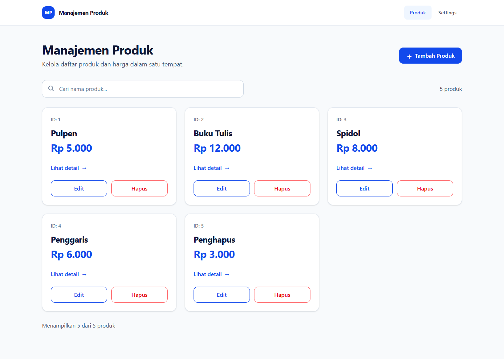

# Manajemen Produk — Tugas 4 React Router & Tailwind CSS

## Menjalankan aplikasi

```bash
npm ci
npm run dev
```

```bash
npm run build
npm run preview
```

## Halaman

| URL | Tampilan |
|---|---|
| `/` | Mengarahkan ke `/products` dengan `Navigate replace` |
| `/products` | Daftar, pencarian, tambah, edit, dan hapus produk |
| `/products/:id` | Detail berdasarkan ID, misalnya `/products/2` untuk Buku Tulis |
| `/settings` | Pilihan tampilan Grid atau List |
| URL lain | Halaman `404 Not Found` dengan tautan kembali |

ID yang tidak tersedia, misalnya `/products/999`, juga menampilkan 404 dengan pesan **Produk tidak ditemukan**. Navigasi menggunakan `Link`/`NavLink`, sehingga Back/Forward bekerja tanpa memuat ulang dokumen.

## Fitur

- Detail menampilkan ID, nama, harga rupiah, dan tautan kembali ke daftar.
- Halaman 404 untuk alamat salah maupun produk yang tidak tersedia.
- Settings mengubah Grid/List, dengan pilihan yang bertahan selama navigasi.
- Styling Tailwind: grid satu kolom di ponsel, dua mulai 768px, dan tiga mulai 1024px.
- Lima produk awal: Pulpen, Buku Tulis, Spidol, Penggaris, dan Penghapus.
- Pencarian nama tanpa membedakan huruf besar/kecil, jumlah hasil, dan keadaan kosong.
- Tambah produk melalui modal dengan ID baru yang tidak dipakai kembali selama sesi.
- Edit nama dan harga dengan mempertahankan ID produk.
- Konfirmasi sebelum menghapus produk dan tombol Batal untuk membatalkan perubahan.
- Validasi nama wajib diisi dan harga berupa bilangan bulat positif dalam batas angka aman JavaScript.
- Navigasi dialog dengan Tab, Shift+Tab, dan Escape serta pengembalian fokus setelah ditutup.

## Penerapan materi React

| Materi | Implementasi |
|---|---|
| JSX dan ekspresi | Judul, nama, harga, dan jumlah produk dalam komponen |
| Komponen reusable | `Button`, `ProductCard`, `SearchBar`, `Modal`, `ProductForm`, dan `DeleteDialog` |
| Props dan callback | Data serta fungsi CRUD dikirim dari `App` ke halaman dan komponen anak |
| State dengan `useState` | Daftar produk, tampilan, pencarian, dialog, notifikasi, nilai form, dan error |
| Conditional rendering | Dialog, validasi, daftar kosong, dan produk tidak ditemukan |
| List dan key | `products.map(...)` dengan `key={product.id}` |
| Pembaruan immutable | Spread, `map`, dan `filter` |
| React Router | `BrowserRouter`, nested `Routes`/`Route`, `Outlet`, `Link`, `NavLink`, `Navigate`, dan `useParams` |
| Tailwind CSS | Plugin `@tailwindcss/vite`, utility JSX, breakpoint `md:`/`lg:`, dan variasi `Button` |

## Struktur

```text
src/
  App.jsx
  main.jsx
  styles.css
  layouts/
    AppLayout.jsx
  pages/
    ProductsPage.jsx
    ProductDetailPage.jsx
    SettingsPage.jsx
    NotFoundPage.jsx
  components/
    Button.jsx
    ProductCard.jsx
    SearchBar.jsx
    Modal.jsx
    ProductForm.jsx
    DeleteDialog.jsx
  data/
    products.js
tests/
  products.spec.js
  routing.spec.js
docs/
  TESTING.md
  TESTING-TUGAS-4.md
  screenshots/
```

## Pengujian

Pengujian otomatis menggunakan Google Chrome yang sudah terpasang.

```bash
npm test -- --workers=2
```

Lihat [hasil dan screenshot Tugas 4](docs/TESTING-TUGAS-4.md). Bukti Tugas 3 tetap tersimpan di [dokumentasi sebelumnya](docs/TESTING.md).

## Hosting SPA

`BrowserRouter` memerlukan fallback ke `index.html` untuk URL aplikasi yang tidak berupa file statis. Server pengembangan dan preview Vite sudah mendukungnya. Saat memasang hasil `dist` pada hosting lain, konfigurasi fallback ini agar akses langsung atau reload `/products/2` tidak menghasilkan 404 dari server hosting.

Halaman 404 di aplikasi adalah tampilan client-side. Kode status HTTP bergantung pada server hosting dan tidak diubah oleh React Router.


