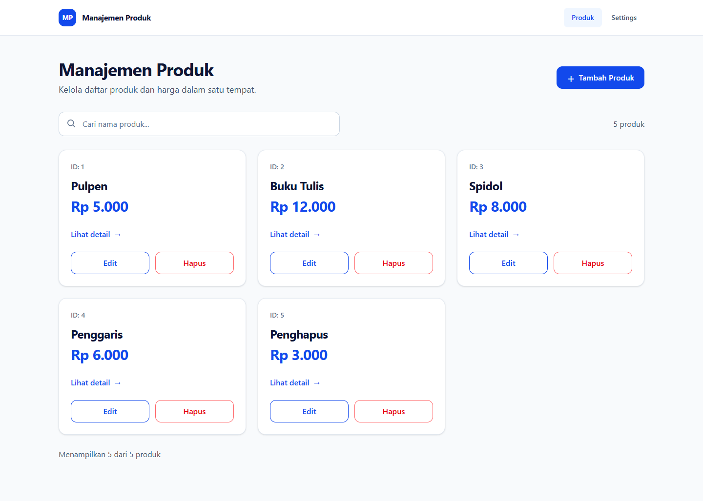
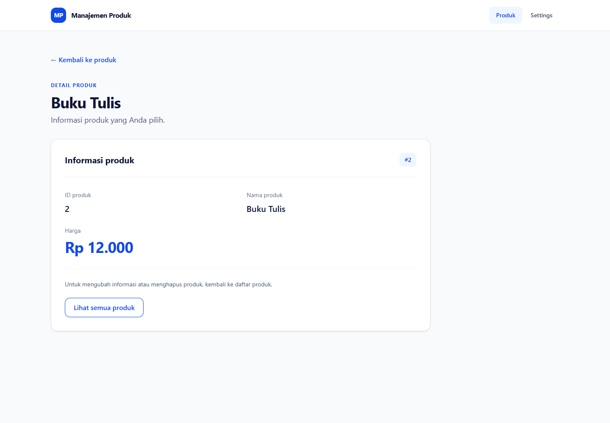
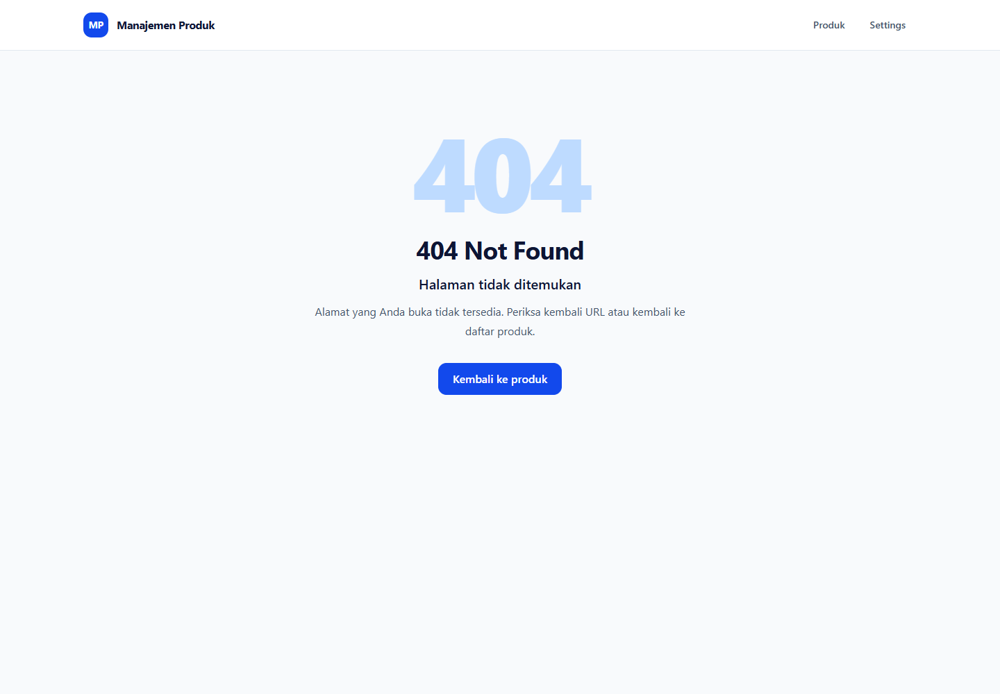
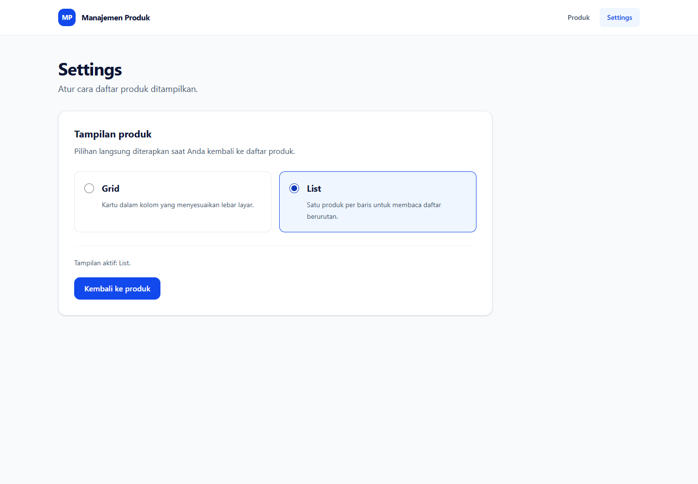
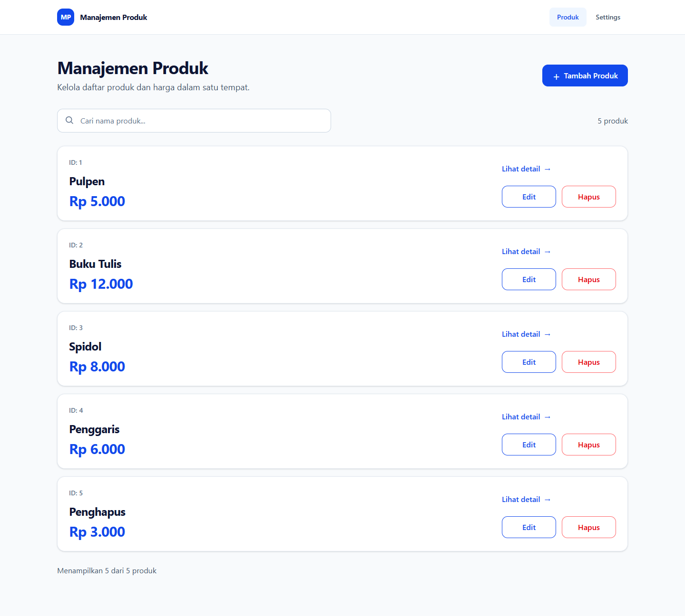

# Bukti Pengujian Tugas 4

Pengujian pada **16 November 2026**, menggunakan Google Chrome headless, Playwright, dan Node.js v24.12.0. Semua skenario dijalankan terhadap **build produksi** melalui Vite preview, bukan mockup.

- Desktop: viewport 1440 × 1000.
- Ponsel: emulasi Pixel 7, viewport 412 × 839. Bukan perangkat fisik.
- Breakpoint tambahan: 390, 820, dan 1280 piksel.
- Hasil: **38/38 pengujian lulus** (19 skenario × 2 viewport).
- Build produksi: **berhasil**.

## Cara menjalankan

Google Chrome harus sudah terpasang.

```bash
npm ci
npm test -- --workers=2
```

Konfigurasi Playwright menjalankan `npm run build` dan `npm run preview -- --port 4175 --strictPort` secara otomatis. Laporan HTML tersedia di `playwright-report/index.html`. Screenshot bukti berada di `docs/screenshots/tugas-4/`.

## Skenario dan hasil aktual

| Skenario | Hasil yang Diharapkan | Hasil Aktual |
|---|---|---|
| Membuka `/` dan daftar produk | Redirect ke `/products`, lima produk dengan ID dan harga rupiah tampil | Sesuai |
| Pencarian dengan kapital/spasi berbeda | Hasil tersaring, jumlah sesuai, hasil kosong dapat dipulihkan | Sesuai |
| Tambah produk | Produk ID 6 muncul, jumlah bertambah, fokus kembali ke tombol tambah | Sesuai |
| Nama kosong dan harga tidak valid | Validasi tampil tanpa menambah data | Sesuai |
| Edit produk | Nilai awal tampil, nama/harga berubah, ID dan jumlah tetap | Sesuai |
| Batal, tutup, dan Escape | Perubahan tidak disimpan, dialog tertutup, fokus kembali | Sesuai |
| Konfirmasi hapus | Batal mempertahankan data; konfirmasi hanya menghapus produk terpilih | Sesuai |
| Hapus semua dan reload | Keadaan kosong tampil; reload mengembalikan data awal | Sesuai |
| Tab dan Shift+Tab pada dialog | Fokus berputar pada kontrol di dalam dialog | Sesuai |
| Klik Detail Buku Tulis | URL menjadi `/products/2`, nama dan harga sesuai, judul tab berubah | Sesuai |
| Back/Forward dan tautan kembali | URL serta konten sinkron, marker dokumen tetap sehingga tidak terjadi reload | Sesuai |
| Buka dan reload detail ID 1, 2, dan 5 | Detail produk yang sesuai tetap ditampilkan | Sesuai |
| URL salah dan nested path tidak dikenal | `404 Not Found`, pesan halaman tidak ditemukan, tautan pemulihan berfungsi | Sesuai |
| ID 999, abc, 2abc, 0, dan 02 | `404 Not Found` dan pesan produk tidak ditemukan | Sesuai |
| Tambah, pindah Settings/detail, edit, hapus, lalu Back | Satu state produk dipakai semua halaman; produk terhapus tidak muncul kembali pada detail | Sesuai |
| Settings List lalu Grid | Tata letak nyata berubah; pilihan bertahan saat berpindah halaman | Sesuai |
| Viewport 390/820/1280 | Grid masing-masing 1/2/3 kolom, tanpa overflow horizontal | Sesuai |
| Edit, cari, dan hapus dalam mode List | CRUD dan pencarian tetap berfungsi tanpa mengubah mode | Sesuai |
| Screenshot semua halaman dan dialog | Tidak ada error JavaScript pada alur screenshot; tampilan terbaca | Sesuai |

Jumlah baris tabel merangkum cakupan pengujian; pemetaan skenario otomatis dapat dilihat di `tests/products.spec.js` dan `tests/routing.spec.js`.

## Screenshot desktop

### Daftar produk



### Detail produk



### Halaman 404



### Settings



### Tampilan List



Bukti tambahan: [Tambah](screenshots/tugas-4/desktop-tambah.png), [Edit](screenshots/tugas-4/desktop-edit.png), [Hapus](screenshots/tugas-4/desktop-hapus.png), dan [ID produk tidak tersedia](screenshots/tugas-4/desktop-produk-tidak-ada.png).

## Screenshot ponsel

[Daftar](screenshots/tugas-4/mobile-daftar.png), [Detail](screenshots/tugas-4/mobile-detail.png), [404](screenshots/tugas-4/mobile-404.png), [Settings](screenshots/tugas-4/mobile-settings.png), [List](screenshots/tugas-4/mobile-list.png), [Tambah](screenshots/tugas-4/mobile-tambah.png), [Edit](screenshots/tugas-4/mobile-edit.png), [Hapus](screenshots/tugas-4/mobile-hapus.png), dan [ID tidak tersedia](screenshots/tugas-4/mobile-produk-tidak-ada.png).

Pemeriksaan visual dilakukan pada daftar desktop, detail ponsel, 404 desktop, Settings desktop/ponsel, dan dialog tambah ponsel.

## Batas pengujian

Data dan pilihan tampilan masih berupa state React yang kembali ke nilai awal setelah reload. Tidak ada integrasi backend. Pengujian browser menggunakan Chrome; tidak mencakup Firefox/Safari. Tampilan 404 di SPA tidak menjamin respons HTTP 404 dari hosting. Hosting produksi perlu fallback ke `index.html` untuk akses langsung ke route aplikasi.
