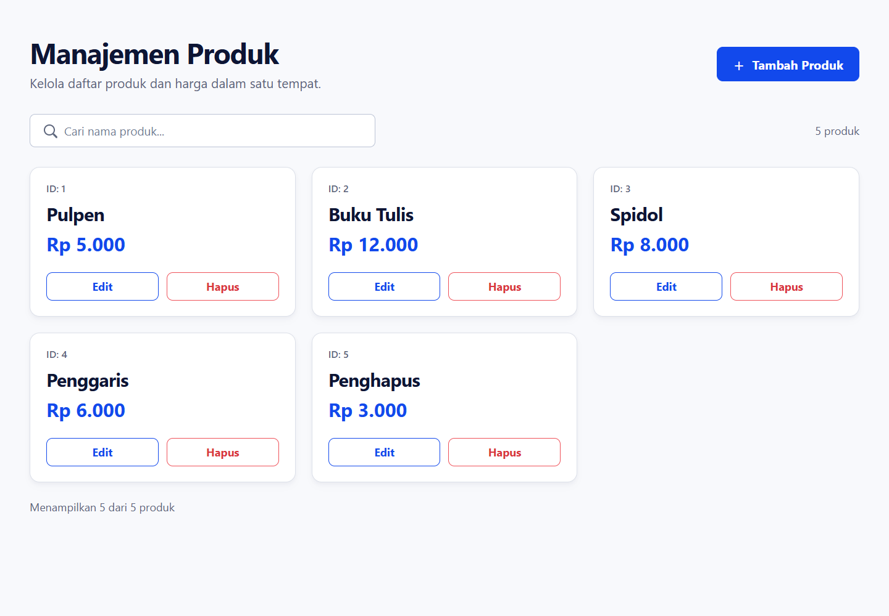
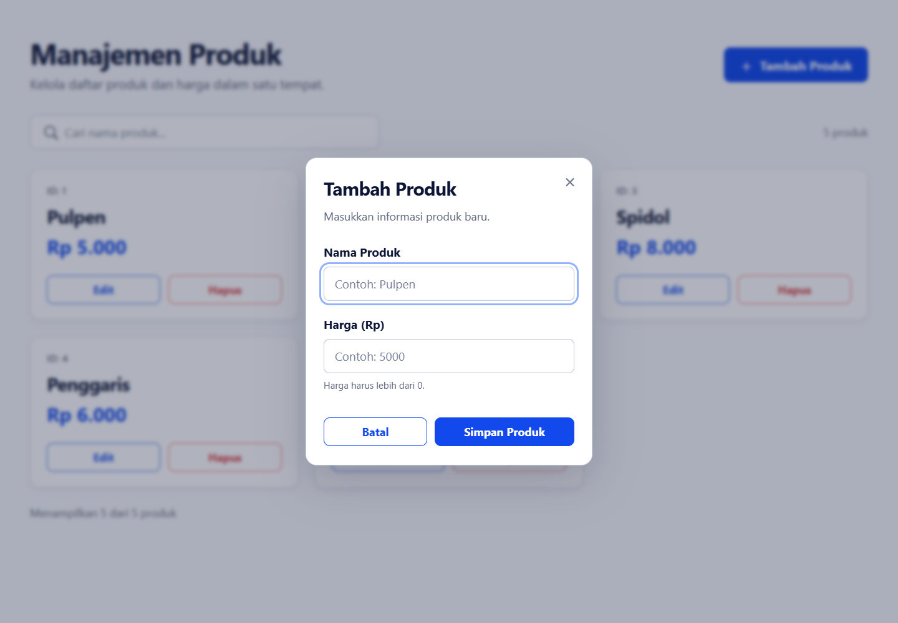
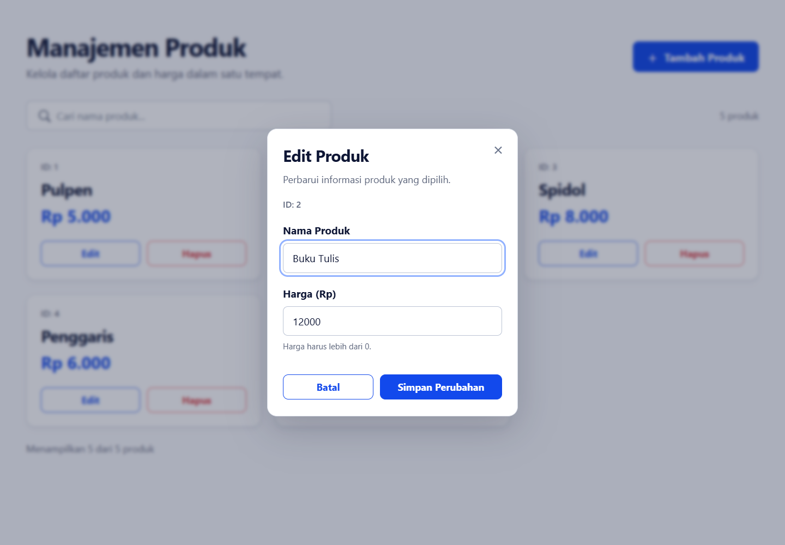
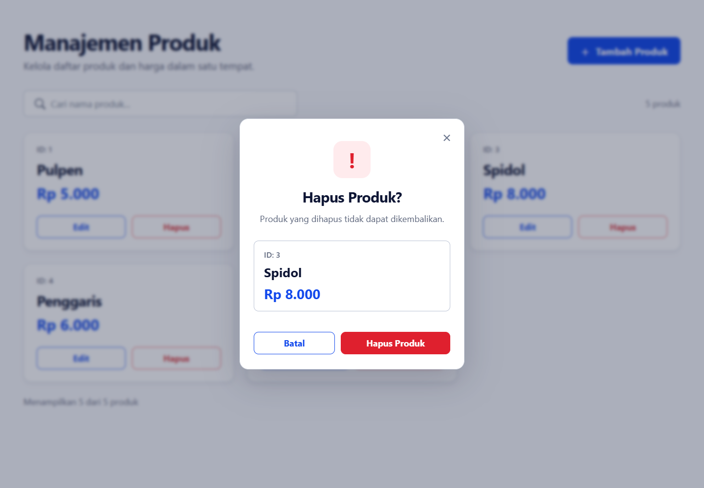

# Bukti Pengujian Tugas 3

Pengujian lokal pada 14 November 2026 menggunakan Node.js v24.12.0, Playwright, dan Microsoft Edge berbasis Chromium dalam mode headless.

- Desktop: viewport 1440 × 1000.
- Ponsel: emulasi Pixel 7, viewport 412 × 839. Ini emulasi browser, bukan pengujian pada perangkat fisik.
- Hasil suite: **20 pengujian lulus** (10 skenario × 2 viewport).
- Build produksi: **berhasil** dengan `npm run build`.
- Pemeriksaan visual: halaman utama desktop dan modal tambah pada ponsel terbaca dan tidak terpotong.

## Skenario

| Skenario | Hasil yang Diharapkan | Hasil Aktual |
|---|---|---|
| Membuka halaman utama | Lima produk, ID, harga rupiah, dan jumlah produk tampil | Sesuai, lulus pada kedua viewport |
| Mencari `  bUkU  ` dan kata yang tidak ditemukan | Pencarian mengabaikan kapital dan spasi tepi; hasil kosong dan tombol hapus pencarian berfungsi | Sesuai, lulus pada kedua viewport |
| Menambahkan Pensil seharga 4000 | Produk ID 6 tampil, jumlah menjadi 6, fokus kembali ke tombol tambah | Sesuai, lulus pada kedua viewport |
| Mengisi nama kosong atau harga kosong, 0, negatif, pecahan, dan angka di luar batas aman | Validasi tampil; dialog tetap terbuka; produk tidak ditambahkan | Sesuai, lulus pada kedua viewport |
| Mengubah Buku Tulis menjadi Buku Gambar seharga 15000 | Form berisi nilai awal; nama/harga berubah; ID 2 dan jumlah produk tetap | Sesuai, lulus pada kedua viewport |
| Membatalkan edit, menutup dialog, dan menekan Escape | Perubahan tidak tersimpan, jumlah tetap, fokus kembali ke pemicu | Sesuai, lulus pada kedua viewport |
| Membatalkan lalu mengonfirmasi penghapusan Penghapus | Batal tidak menghapus; konfirmasi menghapus; penambahan berikutnya memakai ID 6 | Sesuai, lulus pada kedua viewport |
| Menghapus semua produk lalu memuat ulang | Keadaan kosong tampil; setelah reload lima produk awal kembali | Sesuai, lulus pada kedua viewport |
| Menggunakan Tab dan Shift+Tab di dialog | Fokus berputar pada kontrol di dalam dialog | Sesuai, lulus pada kedua viewport |
| Memeriksa lebar halaman dan mengambil screenshot | Tidak ada overflow horizontal atau error JavaScript pada alur screenshot | Sesuai, lulus pada kedua viewport |

## Menjalankan ulang

```powershell
npm ci
$env:PLAYWRIGHT_CHANNEL = 'msedge'
npm test -- --workers=2
npm run build
```

Untuk Chromium bawaan Playwright, jalankan `npx playwright install chromium` lalu `npm test` tanpa variabel `PLAYWRIGHT_CHANNEL`.

Laporan HTML tersedia lokal di `playwright-report/index.html` setelah pengujian. Folder laporan dan dependensi tidak dimasukkan ke Git. Screenshot bukti disimpan dalam repository dan diperbarui saat pengujian screenshot dijalankan.

## Screenshot desktop

### Halaman utama



### Tambah produk



### Edit produk



### Konfirmasi hapus


